# FleetMind

FleetMind is a deterministic synthetic logistics data engineering and delivery-planning platform. It generates a
relational master data set, builds a hard-constrained delivery plan with Google OR-Tools, simulates route execution,
validates the resulting snapshot, injects six anomaly classes, detects them independently, and publishes the results to
Parquet/CSV artifacts and a queryable DuckDB warehouse.

The project is designed to be inspected end to end: every run is reproducible from a YAML configuration and a seed,
every artifact has a logical checksum, and every anomaly has a machine-readable ground-truth record that the detectors
never see.

## Contents

- [What it demonstrates](#what-it-demonstrates)
- [Quickstart](#quickstart)
- [Commands](#commands)
- [Pipeline](#pipeline)
- [Outputs](#outputs)
- [Configuration](#configuration)
- [Anomaly detection](#anomaly-detection)
- [Measured results](#measured-results)
- [Dashboard](#dashboard)
- [Tests](#tests)
- [Documentation](#documentation)
- [Assumptions and limitations](#assumptions-and-limitations)

## What it demonstrates

- **Deterministic generation.** Seeded, component-isolated NumPy/Faker generators produce stable IDs and stable
  records for a fixed configuration. IDs include `ORD-2026-000001`, `DEL-2026-000001`, `VEH-000001`,
  `DRV-000001`, `RTE-2026-000001`, and `STOP-RTE-2026-000001-001`.
- **Hard-constrained routing.** OR-Tools enforces vehicle capacity, weight capacity, driver shift, site access,
  required equipment, certification, license class, time windows, and maximum route duration. A delivery that cannot
  be served is recorded as `UNSERVED` with an explicit reason instead of violating a constraint.
- **Execution simulation.** Planned routes are executed with dispatch delays, leg-level travel variance, service
  variance, customer-unavailable failures, late-arrival handling, proof of delivery, and a complete event ledger.
- **Data quality.** A typed rule engine validates master, plan, simulation, and lifecycle data. Invalid records are
  quarantined with the original JSON payload and a reason.
- **Separated anomaly ground truth.** Six anomaly types are injected into a copy of the clean execution snapshot.
  Detectors read only operational tables; ground truth is used exclusively by the evaluation layer.
- **Idempotent persistence.** DuckDB holds run-scoped snapshots keyed by `(run_id, entity_id)`. Re-running an
  identical configuration replaces that run atomically instead of duplicating it.
- **Measured benchmarks.** Stage timings, solver seconds per service day, throughput, peak RSS, and tracemalloc peaks
  are recorded in JSON and Markdown, with no hard-coded performance claims.
- **Read-only control tower.** A five-tab Streamlit dashboard queries DuckDB directly for KPIs, routes, execution
  outcomes, quality issues, and anomaly performance.

## Quickstart

Requires Python 3.11–3.13. OR-Tools wheels are not available for every newer Python release, so use a supported
interpreter when creating the virtual environment.

```powershell
git clone <repository-url> FleetMind
cd FleetMind

py -3.13 -m venv .venv
.\.venv\Scripts\Activate.ps1
python -m pip install --upgrade pip
pip install -e ".[dev]"
```

Run the small starter configuration (40 sites, 120 orders, 12 vehicles, 7 days):

```powershell
python -m fleetmind run --config starter
```

The default warehouse is `outputs/fleetmind.duckdb`. The command prints the run ID, KPI summary, stage timings, and
artifact locations.

Inspect the configured identity without running the pipeline:

```powershell
python -m fleetmind info --config starter
```

## Commands

| Command | Purpose |
|---|---|
| `fleetmind run --config starter` | Generate, plan, simulate, validate, inject/detect anomalies, report, and persist. |
| `fleetmind run --config baseline --no-anomalies` | Clean-only run; skips injection, detection, and dirty validation. |
| `fleetmind info --config baseline` | Print the resolved configuration hash and deterministic run ID. |
| `fleetmind runs --database outputs/fleetmind.duckdb` | List persisted runs. |
| `fleetmind schema --show` | Print the generated warehouse DDL. |
| `fleetmind schema --output schema.sql` | Export the generated DDL. |
| `fleetmind dashboard --database outputs/fleetmind.duckdb` | Launch the read-only Streamlit dashboard. |
| `fleetmind benchmark --configs baseline,larger` | Measure cold pipeline runs and write JSON + Markdown reports. |

`python -m fleetmind ...` and the installed `fleetmind ...` entry point are equivalent. Bare configuration names
resolve to `configs/<name>.yaml`; explicit relative or absolute paths are also accepted.

Useful options for `run`:

```text
--output, -o       Artifact root (default: outputs)
--database, -d     DuckDB path (default: <output>/fleetmind.duckdb)
--anomalies        Inject and detect anomalies (default)
--no-anomalies     Skip the anomaly stage
--formats          Comma-separated artifact formats: parquet, csv
```

## Pipeline

```mermaid
flowchart LR
    A[YAML config] --> B[Generate master data]
    B --> C[Validate master]
    C --> D[OR-Tools planning]
    D --> E[Execution simulation]
    E --> F[Validate clean snapshot]
    F --> G[Reporting + reconciliation]
    G --> H{Anomalies enabled?}
    H -- yes --> I[Inject six anomaly classes]
    I --> J[Independent detection]
    J --> K[Validate dirty snapshot]
    K --> L[Ground-truth evaluation]
    H -- no --> M[Persist clean run]
    L --> M
    M --> N[Parquet/CSV artifacts]
    M --> O[DuckDB warehouse]
    O --> P[Streamlit dashboard]
```



The in-memory stages are implemented in `fleetmind.pipeline.build_pipeline_run`; persistence is deliberately separate
in `persist_pipeline_run` so benchmarks can time the full pipeline, and so failed runs can still write evidence.

### Determinism

- A single `seed` (baseline: `20261022`) drives every generator through SHA-256-derived, component-labelled
  `numpy.random.Generator` instances.
- Configuration is normalized through Pydantic and hashed canonically. The run ID is `RUN-` plus the first 12
  uppercase hex characters of that hash, so an identical configuration always maps to the same run ID.
- Tables are normalized and sorted before artifact writes. Logical checksums hash canonical typed CSV text, not Parquet
  byte layout, so they are stable across Arrow versions. The measured `solve_seconds` column is excluded, so solver
  wall-clock jitter cannot change a data checksum.
- Run-level wall-clock fields such as `run_metadata.started_at`, `run_metadata.completed_at`, and audit timestamps
  live outside the checksummed tables. Entity `created_at` values are generated deterministically from the service
  calendar.

### Constraint handling

Planning fails closed: every planned stop has a feasible assignment, and every requested delivery receives exactly one
`delivery_assignments` row. If no eligible vehicle can serve a delivery, the assignment is `UNSERVED` with a reason
such as `NO_ELIGIBLE_VEHICLE`, `OUTSIDE_SHIFT`, `CAPACITY_EXCEEDS_FLEET`, or `TIME_WINDOW_INFEASIBLE`. The planner
never silently drops demand or relaxes a hard rule.

## Outputs

Each run writes a self-describing directory:

```text
outputs/
├── fleetmind.duckdb
└── RUN-<CONFIG_HASH>/
    ├── config.yaml
    ├── manifest.json
    ├── summary.json
    ├── checksums.json
    ├── master/          # depots, sites, time windows, orders, deliveries, vehicles,
    │                    # capacities, equipment, drivers, certifications, shifts,
    │                    # scenarios, travel matrix
    ├── plan/            # routes, stops, legs, assignments, solver runs
    ├── simulation/      # executed routes/stops/legs, outcomes, route/delivery events
    ├── anomalies/       # ground truth, detections, detection metrics, dirty snapshots
    ├── validation/      # clean/dirty issues and quarantine records
    ├── quarantine_dirty/# records removed from the dirty snapshot
    └── reports/         # KPI metrics and reconciliation checks
```

`summary.json` contains the KPI headline, count inventory, validation status, anomaly metrics, reconciliation result,
stage timings, checksums, and warehouse table counts. `manifest.json` records the artifact inventory, row counts,
column lists, logical checksums, and requested formats.

A representative starter run is checked in under [`data/sample/starter-run`](data/sample/starter-run) (CSV and JSON
only; the DuckDB file is intentionally not committed). It contains 25 routes, 118 assigned deliveries, 116 delivered,
2 failed, 2 unserved, and all six anomaly types detected with F1 1.0.

## Configuration

Configurations use YAML with an optional `extends` chain. `configs/baseline.yaml` is the assessment baseline:
500 customer sites, 2,000 deliveries, 100 vehicles, 100 drivers, 30 days, seed `20261022`.

| Config | Sites | Orders | Vehicles | Days | Solver limit/day | Purpose |
|---|---:|---:|---:|---:|---:|---|
| `starter.yaml` | 40 | 120 | 12 | 7 | 5 s | Fast local iteration and dashboard data |
| `baseline.yaml` | 500 | 2,000 | 100 | 30 | 10 s | Required assessment scale |
| `larger.yaml` | 750 | 4,000 | 150 | 30 | 15 s | Scale and memory headroom |

The most important settings:

| Section | Keys | Meaning |
|---|---|---|
| `region` | `min_lat`, `max_lat`, `min_lon`, `max_lon`, `clusters` | Geographic envelope and site clustering. |
| `horizon` | `start_date`, `days` | Service calendar. Generation begins on `2026-11-02`. |
| `generation` | `customer_sites`, `orders`, `vehicles`, `drivers`, mixes | Dataset scale and categorical distributions. |
| `routing` | `time_limit_seconds`, `max_stops_per_route`, costs | OR-Tools search budget and objective weights. |
| `simulation` | variance, delay, failure rate | Deterministic execution variability. |
| `anomaly` | `instances_per_type`, coordinate margin | Injection volume. |
| `reporting` | `on_time_grace_minutes`, `top_n` | KPI definitions and ranked dimensions. |

## Anomaly detection

The six required anomaly classes are injected into an in-memory copy of the clean snapshot:

| Anomaly | Injection | Independent detection rule |
|---|---|---|
| `ROUTE_CAPACITY_EXCEEDED` | Inflate one stop's demand above the assigned vehicle's unit capacity. | Recompute route load from `route_stops`; compare with `vehicle_capacities`. |
| `STOP_OMITTED` | Remove a stop while its assignment remains `ASSIGNED`. | Find assigned deliveries with no `route_stops` row. |
| `STOP_DUPLICATED` | Add a second stop for one assigned delivery on the same route. | Count stops per delivery; flag deliveries with more than one. |
| `ARRIVAL_BEFORE_PREVIOUS_DEPARTURE` | Move a later stop's actual arrival before the preceding actual departure. | Order stops by sequence; compare actual arrival with the previous actual departure. |
| `DRIVER_SHIFT_EXCEEDED` | Extend an untouched route's actual end beyond its shift's planned end. | Compare route `actual_end` with `shifts.planned_end`. |
| `COORDINATE_OUT_OF_REGION` | Move a site outside the configured regional envelope. | Compare site coordinates with `region` bounds. |

Injection records `original_value`, `injected_value`, the affected entity, and a note in
`ground_truth_anomalies`. Detection reads only operational tables. Evaluation matches predictions to ground truth by
exact `(issue_type, entity_id)` and reports per-type TP/FP/TN/FN, precision, recall, F1, and the evaluated universe.

Injected and dirty records are persisted separately from the valid clean snapshot (`dirty_routes`,
`dirty_route_stops`, `dirty_delivery_assignments`, `dirty_customer_sites`), so downstream consumers can compare the
clean and corrupted worlds without losing either.

## Measured results

The full benchmark report is checked in at
[`outputs/benchmarks/benchmark_report.md`](outputs/benchmarks/benchmark_report.md). The outputs directory is normally
ignored by Git; this report is force-added as evidence. Measurements were taken on 2026-10-31 on one Windows 11
machine with Python 3.13.9, 12 logical CPUs, 7.28 GB RAM, OR-Tools 9.15.6755, DuckDB 2.0.0, Pandas 2.3.3, and NumPy
2.3.5. Each configuration was run cold once.

| Config | Sites | Orders | Vehicles | Days | Total (s) | Plan (s) | Peak RSS (MB) | Routes | Delivered | Service rate | F1 |
|---|---:|---:|---:|---:|---:|---:|---:|---:|---:|---:|---:|
| baseline | 500 | 2,000 | 100 | 30 | 518.34 | 311.50 | 445.9 | 296 | 1,991 | 99.55% | 1.000 |
| larger | 750 | 4,000 | 150 | 30 | 953.85 | 481.75 | 859.7 | 521 | 3,984 | 99.60% | 1.000 |

Both benchmark runs passed clean validation with zero issues, served every requested delivery (0 unserved), and
detected every injected anomaly with perfect precision and recall. Solver wall time was 311.35 s / 30 days
(10.38 s per day) for baseline and 481.27 s / 30 days (16.04 s per day) for larger.

Benchmark totals include artifact persistence (Parquet + CSV), DuckDB writes, both validation passes, injection,
detection, and reporting. They are not solver-only timings. The stage-level breakdown and the measurement method are
in [`docs/benchmark_methodology.md`](docs/benchmark_methodology.md).

## Dashboard

```powershell
python -m fleetmind dashboard --database outputs/fleetmind.duckdb
```

The Streamlit app opens on port 8501 by default. It selects the latest run from the DuckDB warehouse and provides:

1. **Overview** — KPI cards, daily service/failure trend, priority and handling splits, reconciliation status.
2. **Routing & fleet** — route table, capacity utilization, distance by vehicle type, and a Plotly route map.
3. **Execution** — outcome mix, on-time performance, failure reasons, route event drill-down.
4. **Data quality** — clean/dirty issue counts by type and severity, quarantine records.
5. **Anomalies** — ground truth vs. detections, per-type precision/recall/F1, and detection details.

The dashboard is read-only; it never writes to the warehouse. Set `FLEETMIND_DB` to override the default database path,
or pass `--database` to the CLI launcher. The standalone wrapper is `dashboard/app.py`.

## Tests

```powershell
python -m pytest -q
python -m pytest -q -m "not slow"
```

The suite covers deterministic generation, ID sequencing, geography and travel modelling, configuration merging and
validation, routing constraints, simulation behaviour, all six anomaly injectors and detectors, quarantine, warehouse
idempotency and rollback, reporting reconciliation, CLI behavior, dashboard data helpers, Streamlit smoke tests, and
the measured benchmark writer. `tests/integration` uses a tiny 12-site configuration so the full pipeline runs in
seconds without mocking OR-Tools.

Latest verification is recorded in the final commit history and in [`docs/verification.md`](docs/verification.md).

## Documentation

- [Architecture](docs/architecture.md)
- [Data dictionary](docs/data_dictionary.md)
- [Validation rules](docs/validation_rules.md)
- [Anomaly methodology](docs/anomaly_methodology.md)
- [Operations guide](docs/operations.md)
- [Assumptions](docs/assumptions.md)
- [Benchmark methodology](docs/benchmark_methodology.md)
- [Verification record](docs/verification.md)
- [Prompt history](prompt_history/README.md)

## Assumptions and limitations

- Travel times use a static Haversine distance multiplied by a road-network factor, then perturbed by a daily scenario
  multiplier during planning and leg-level variance during simulation. This is a synthetic model, not a live traffic
  feed.
- One depot, one region, and one daily planning horizon per service date. Multi-depot and multi-day route continuity
  are out of scope.
- The benchmark is a single cold run per configuration, not a statistical distribution. Absolute timings depend on
  hardware and solver search behavior.
- Anomaly detection is rule-based and evaluated on exactly the six injected classes; it is not a general-purpose
  anomaly classifier.
- The dashboard requires a warehouse produced by `fleetmind run` and intentionally fails gracefully when none exists.
